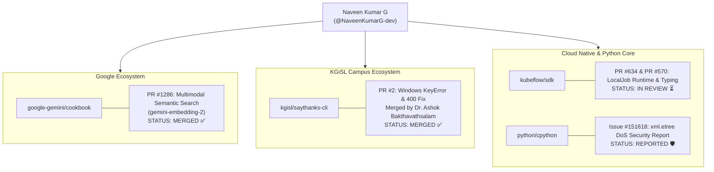

# 📋 Complete Profile & Technical Intelligence Dossier: Naveen Kumar G

**Subject:** Naveen Kumar G  
**Primary GitHub Handle:** [`@NaveenKumarG-dev`](https://github.com/NaveenKumarG-dev)  
**Secondary / Project Handle:** [`@naveen21-11`](https://github.com/naveen21-11)  
**Institution:** KGiSL Institute of Technology (KG KITE), Coimbatore, Tamil Nadu  
**Document Generated:** September 9, 2026  

---

## 1. Executive Summary & Identity

| Field | Primary Profile Detail | Secondary / Alternate Profile |
| :--- | :--- | :--- |
| **Full Name** | **Naveen Kumar G** | Naveen V |
| **GitHub Handle** | [`@NaveenKumarG-dev`](https://github.com/NaveenKumarG-dev) | [`@naveen21-11`](https://github.com/naveen21-11) |
| **Public Email** | `naveen13524g@gmail.com` | Not publicly listed |
| **User ID** | `185482416` (Node: `U_kgDOCw48sA`) | `194389087` (Node: `U_kgDOC5YZXw`) |
| **Bio / Headline** | *"Aspiring AI engineer \| Problem solver \| Data Science enthusiast \| Passionate about building real-world solutions with code \| Exploring new tech, one project"* | — |
| **Account Created** | **October 18, 2024** | **January 9, 2025** |
| **Public Repositories**| **76 public repos** | 7 public repos |
| **Followers / Following**| **29 followers** / 25 following | 0 followers / 1 following |
| **Institution** | KGiSL Institute of Technology (KG KITE) | KGiSL Institute of Technology |
| **Primary Focus Areas**| Data Science, Machine Learning, Upstream CPython / Kubeflow / Gemini API | Web Frontend & Utilities (`jeevakarangal`, `adraco`) |

---

## 2. Technical Profile & Core Stack

Naveen is one of the most prolific student developers at KGiSL, characterized by high-volume coding, aggressive open-source upstream contributions, and practical ML/IoT projects.

### Primary Programming Languages (by repo frequency)
1. **Python** (25+ repositories) — Core data science, machine learning models, Flask/Django APIs, and CLI tooling.
2. **Jupyter Notebooks** (19+ repositories) — Exploratory Data Analysis (EDA), ML training, model evaluation, and computer vision experiments.
3. **TypeScript / JavaScript** (14+ repositories) — Full-stack frontends, React web applications, and utility platforms.
4. **C++ / Java / HTML / CSS** — Problem solving on LeetCode/HackerRank, university lab coursework (`3rd-sem-lab`, `CN-model-Lab`).

### Key Technical Competencies
- **Machine Learning & Data Science:** XGBoost, Scikit-learn, Random Forest, SVM, Pandas, NumPy, Data Cleaning, Imbalanced Dataset Oversampling.
- **Generative AI & LLMs:** Google Gemini API (`google-genai` SDK), Multimodal Embeddings (`gemini-embedding-2`), LangChain, RAG architectures.
- **Systems & Cloud Infrastructure:** Kubernetes Kubeflow SDK, Docker, CPython core internals (`xml.etree`, `mimetypes`).
- **Hardware & IoT Ingestion:** Physical sensors coupled with Python analytics (Milk Analyzer, Air Quality Monitor).

---

## 3. Verified Upstream Open-Source Contributions

Naveen has actively targeted major global repositories and official institutional codebases:



### 1. `google-gemini/cookbook` (Google Official AI Repository)
- **PR #1286:** [Add Multimodal Semantic Search quickstart using gemini-embedding-2](https://github.com/google-gemini/cookbook/pull/1286)
  - **Status:** **MERGED ✅** (Merged on July 27, 2026)
  - **Reviewers:** **Mark McDonald (`@markmcd`)** (Developer Advocate at Google) & **Krzysztof Korpal (`@kkorpal`)** (Google Collaborator).
  - **What he built:** Created `examples/Multimodal_Semantic_Search.ipynb` demonstrating how to generate unified multimodal embeddings across text and images, calculate cosine similarities, and handle Dark Mode notebook rendering.
- **PR #1266:** [fix: migrate 2 legacy notebooks from google-generativeai to google-genai SDK](https://github.com/google-gemini/cookbook/pull/1266) (Closed / Superseded)
- **Issue #1260:** [Proposal: Meaning-based Multimodal Search with Gemini Embedding 2](https://github.com/google-gemini/cookbook/issues/1260) (Approved & implemented via PR #1286)

### 2. `kgisl/saythanks-cli` (Official KGiSL Repository)
- **PR #2:** [Fix: Resolve 400 Bad Request and Windows KeyError issues during note submission](https://github.com/kgisl/saythanks-cli/pull/2)
  - **Status:** **MERGED ✅** (Merged by **Dr. Ashok Bakthavathsalam (`@kgashok`)** on August 23, 2026)
  - **What he fixed:**
    1. Added missing `content-type` payload parameter required by Werkzeug.
    2. Fixed Windows environment variable resolution: replaced Unix `os.environ['USER']` with Windows `USERNAME` fallback to prevent silent request failures.
  - **Clout:** Naveen is ranked as the **#3 contributor** on `kgisl/saythanks-cli` with commits directly accepted into master.

### 3. `kubeflow/sdk` (Kubernetes Kubeflow AI Workloads)
- **PR #634:** [fix(trainer): add LocalJob test coverage and fix runtime bugs](https://github.com/kubeflow/sdk/pull/634)
  - **Status:** **OPEN ⏳** (Active review with Kubernetes Prow bot and maintainers)
  - **Issue #633:** [bug(trainer): Zero test coverage for LocalJob execution logic in localprocess backend](https://github.com/kubeflow/sdk/issues/633)
- **PR #570:** [fix(trainer): strictly type steps in LocalProcess backend to prevent NoneType iteration](https://github.com/kubeflow/sdk/pull/570)
  - **Status:** **OPEN ⏳**
  - **Issue #569:** [bug: TypeError: 'NoneType' object is not iterable in LocalProcess backend](https://github.com/kubeflow/sdk/issues/569)

### 4. `python/cpython` (Official Python Core Language)
- **Issue #151618:** [xml.etree.ElementTree: missing nesting depth limit allows DoS via deeply nested XML](https://github.com/python/cpython/issues/151618)
  - Reported security vulnerability regarding stack overflow / DoS via deeply nested XML structures.
- **PR #151620:** [gh-151618: Add nesting depth limit to xml.etree.ElementTree TreeBuilder](https://github.com/python/cpython/pull/151620) (Closed for design discussion)
- **Issue #151575 & PR #151576:** [Deprecate passing file paths instead of URLs to mimetypes.guess_type()](https://github.com/python/cpython/issues/151575)

### 5. `pandas-dev/pandas` (Core Python Data Science Library)
- **PR #66695:** [TST: Replace hypothesis with fixed pytest parameterizations](https://github.com/pandas-dev/pandas/pull/66695) (Closed after maintenance rebase)

---

## 4. Notable Self-Authored Repositories & Projects

Out of his 76 public repositories, these represent his core signature work:

| Repository | Tech Stack | Purpose / Architectural Description |
| :--- | :--- | :--- |
| [`Plastic-Ledger`](https://github.com/NaveenKumarG-dev/Plastic-Ledger) | Python, XGBoost, Scikit-Learn | Autonomous micro-plastic fingerprinting, spectral identification, and environmental source attribution using machine learning models. |
| [`Portable-Milk-Analyzer`](https://github.com/NaveenKumarG-dev/Portable-Milk-Analyzer) | Python, IoT, Sensors | Portable hardware-to-software milk quality and adulteration analyzer using sensor reading pipelines. |
| [`Air-Quality-Checker`](https://github.com/NaveenKumarG-dev/Air-Quality-Checker) | Python, Jupyter Notebook | Environmental air quality monitoring and index forecasting based on particulate matter data. |
| [`EduSense-AI`](https://github.com/NaveenKumarG-dev/EduSense-AI) | Python, OpenCV, Flask | Smart classroom monitoring with facial recognition, safety alert notifications, and attendance verification. |
| [`AI-powered-Learning-platform`](https://github.com/NaveenKumarG-dev/AI-powered-Learning-platform) | TypeScript, LangChain, Docker | Full-stack interactive learning portal with automated course curriculum planning, interactive mind maps, and coding assessments. |
| [`Chronic-kidney-disease`](https://github.com/NaveenKumarG-dev/Chronic-kidney-disease) | Python, Jupyter Notebook | Healthcare diagnostic ML model classifying CKD using patient blood pressure, glucose, and creatinine metrics. |
| [`TN-Scheme-Compass`](https://github.com/NaveenKumarG-dev/TN-Scheme-Compass) | Python, Flask, HTML | Public welfare scheme discovery portal for Tamil Nadu government beneficiary programs. |

---

## 5. Mutual Collaboration & Shared Repositories

Nandhakumar and Naveen have shared touchpoints across several repositories:

1. **`naveen21-11/jeevakarangal`**:
   - A community social service repository where Nandhakumar holds collaborator write permissions (`push: True`, `pull: True`).
2. **`nandhakumar-murugan/https---github.com-naveen21-11-adraco`**:
   - Private cloned portal and interactive web structure preserved in Nandhakumar's account.
3. **`saythanks` Ecosystem**:
   - Naveen contributed the CLI submission fix to `kgisl/saythanks-cli` (merged by Dr. Ashok).
   - Nandhakumar is implementing the offline-first Progressive Web App (PWA) architecture on `BlitzKraft/saythanks.io` (Issue #512).
4. **Google Gemini Developer Ecosystem**:
   - Both have submitted PRs to `google-gemini/cookbook` (Naveen on PR #1286 for Multimodal Search; Nandhakumar on PR #1352 for Indic Multimodal Recipes).

---

## 6. Strategic Comparison: Naveen vs. Nandhakumar

```
┌─────────────────────────────────────────────────────────────────────────┐
│                      CAMPUS POWER DUO ARCHITECTURE                      │
├────────────────────────────────────┬────────────────────────────────────┤
│       🔬 NAVEEN KUMAR G            │       👑 NANDHAKUMAR MURUGAN       │
│    Data Engineering & ML Core      │     Lead AI, Security & Ecosystem  │
├────────────────────────────────────┼────────────────────────────────────┤
│ • 76 Public Repositories           │ • 87 Total Repos (60 pub + 27 priv)│
│ • Merged PR on Gemini Cookbook     │ • Official Google Student Amb. (GSA│
│   (Multimodal Embedding #1286)     │ • Active PR on Gemini Cookbook     │
│ • Merged PR on saythanks-cli (#2)  │   (Indic Multimodal Recipe #1352)  │
│ • CPython / Kubeflow Contributor   │ • Verified Google Individual CLA   │
│ • Hardware / Sensor Ingestion      │ • 100% Licensed Repos (MIT/Apache) │
│ • Algorithmic ML Models (XGBoost)  │ • Full-Stack Android (Kotlin) & Web│
└────────────────────────────────────┴────────────────────────────────────┘
```

### Collaboration Recommendation
Rather than viewing each other strictly as competitors, **combining forces produces an unstoppable hackathon and open-source team**:
- **Nandhakumar:** System Architecture, Google Student Ambassador leadership, Cyber Security & API governance, Gemini 2.0 multimodal prompt pipelines, mobile client UI.
- **Naveen:** Feature engineering, dataset preprocessing, Kubeflow / ML training pipelines, custom algorithmic tuning, and sensor telemetry.
